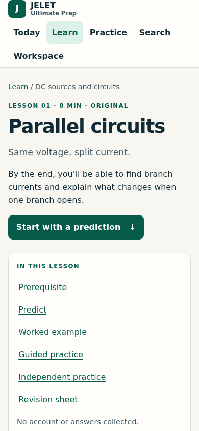
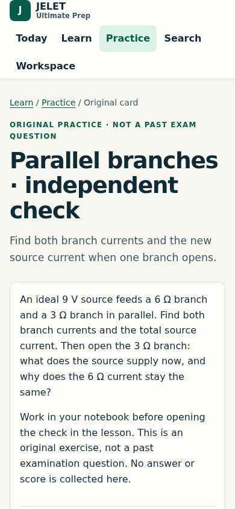
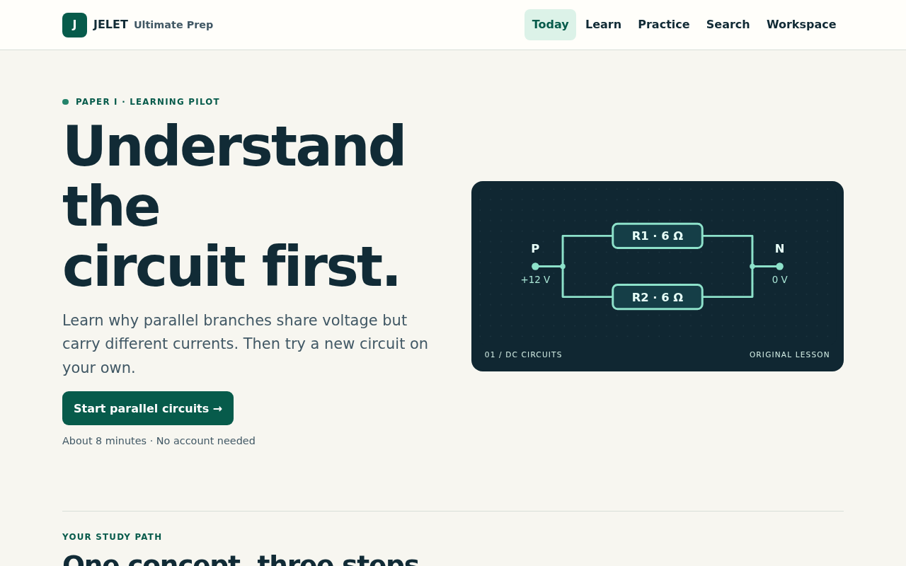

# What the three merges actually deliver

Inspected `bacd773` (main baseline), the published-release record, the content collections and the produced routes. “Merged” describes the code/history, not sign-off on every educational or visual claim.

| Phase | Evidence in this branch | Preserve / do not infer |
|---|---|---|
| 01 Evidence | [42 syllabus groups; ten audited Set A items; chapter outline](../01-evidence/2026-11-19-phase-01.md) | Reuse topic IDs and findings. All ten items held: not ten playable questions. |
| 02 Learning | [Pilot record](../02-learning/2026-11-19-phase-02.md), [lesson source](../../../src/content/parallel-circuits.md) | One original English lesson with worked/guided/independent cases. Keep anchors, notebook mode, hints and local resume. Android pass reported; transfer not measured. |
| 03 Library | [Release evidence](../03-library/2026-11-19-03.5-release.md), [practice record](../../../src/content/practice/parallel-independent-v1.md) | Stable original card, search, share, workspace and backup; seven static HTML pages. **Zero public legacy PYQ pages**. No score/verified PYQ solution. Independent editorial/accessibility review remains open. |

## The current viewport, not a mockup

| Lesson · first 390 × 844 | Practice · first 390 × 844 |
|---|---|
|  |  |

[Open the unaltered desktop practice capture, 1280 × 800](visuals/practice-desktop.png). Captured at CSS viewport scale from a fresh browser context; no personal activity or private notes.

| Observation | Consequence for a learner | Acceptance target for the replacement |
|---|---|---|
| At 390px, Workspace wraps to a separate nav row. The practice title, summary and then question repeat the task; the problem starts about halfway down the screen. | Reading starts late and navigation competes with the problem. | Single compact phone header; show original/PYQ identity and first actionable problem or prediction within first viewport at 390×844. No clipping at 320px/200% text. |
| The lesson's six-link contents panel consumes the lower mobile viewport before the teaching text. | Knowing *where* to go is easier than beginning to learn. | Collapse contents on small screens; retain native heading links and a keyboard-accessible jump back. No JS required for text or navigation. |
| Today has a strong primary action but promotes one chapter, and practice/source labels have no corresponding year library. | The student cannot discover what historical material exists or why a key is unavailable. | Offer “Study this chapter” and a secondary year catalogue with denominators and link-only/held explanations; do not call library entries scoreable. |

### Verification · current baseline

With Node 22.23.4 and lockfile: `npm ci`, `npm run check` (21 files, zero diagnostics), `npm run build` (7 pages), `npm run test:browser` (19/19, Chromium 153.0.8010.0). On this minimal Linux host Chromium first failed to launch due to missing NSS/NSPR; using the library directory from the pinned `@sparticuz/chromium/bin/al2023.tar.br` via `LD_LIBRARY_PATH` resolved it. Reproduce captures by serving the built project at `/Jelet-ultimate-prep/`, using fresh contexts at the labelled viewports and recording the first viewport of Today, the parallel-circuits lesson and the original card. These are browser observations, **not** new physical Android, learning-transfer or accessibility sign-offs.
