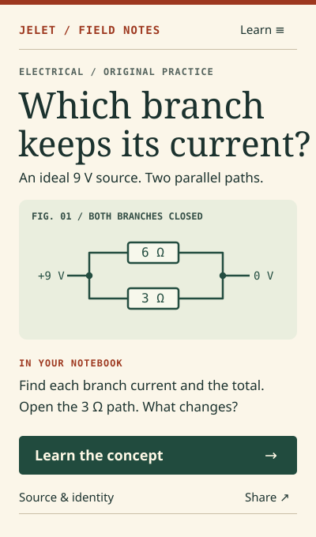
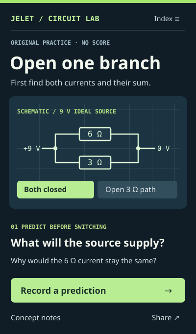

# Studio 03R · From pilot to study edition

**Design and content recovery · after the three merged phases · before expanding scored practice**

A student with a printed question should be able to answer three things in seconds: **What am I looking at? Can I trust this answer? Where do I learn the method?** A student starting from zero should see the explanation before the navigation. That is the design brief. Not more dashboard tiles.

**Read in order:** [What actually shipped](BASELINE.md) → [where the seven papers went](LEGACY.md) → [two design directions and references](DESIGN.md) → [execute the phase](RUNBOOK.md).

## The decision board

Two **original proposed interfaces**, not screenshots of shipped work. Both use the *same* published original 9 V practice case. This isolates the difference in teaching interaction instead of comparing unrelated content. No Board material is reproduced.

| A · Field notebook | B · Circuit bench |
|---|---|
|  |  |
| Read a short problem, inspect the drawing, work on paper. Best default across all four subjects; inexpensive to load. | Make a prediction, switch one branch, compare the model with the prediction. Strong for electrical/physics; inappropriate where no meaningful manipulation exists. |

**Recommendation:** A for the common reading/practice shell, B as an optional lab *inside* suitable lessons. The bench must not replace the written explanation or require a screenshot, GPU, login or live AI call. Owner can choose A only, B as primary, or the recommended combination before rollout. Until then do all independent cataloguing, checks and prototype work; don't block an entire phase on a colour choice.

**Asset provenance:** the cover is AI-generated editorial art, not an electrical reference. The two SVGs are authored design illustrations with accessible titles/descriptions and labelled terminal potentials. The four PNGs in [the baseline](BASELINE.md) are captures from the actual built app. All stay in documentation, outside the public artifact. No third-party UI code, assets or fonts were imported.
